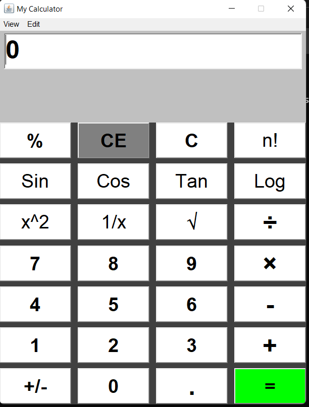

# 🧮 Calculator

A modern calculator application built using Java AWT. This project demonstrates GUI development in Java and offers both basic and scientific functionalities.

## ✨ Features

- 🖱️ User-friendly interface
- ➕ Addition, ➖ Subtraction, ✖️ Multiplication, ➗ Division
- 🧑‍🔬 Scientific functions:
  - 🟰 Sine (`sin`)
  - 🟰 Cosine (`cos`)
  - 🟰 Tangent (`tan`)
  - 📊 Logarithm (`log`)
  - 🎯 Percentage (`%`)
  - 🔢 Factorial (`n!`)
  - 🧮 Square (`x²`)
  - ↩️ Reciprocal (`1/x`)
  - 🟦 Square root (`√`)
- ⚡ Responsive layout

## 🖼️ The final look of my simple calculator

<div>
    <div align="center">
        
    </div>
</div>

## 🚀 Getting Started

### 📋 Prerequisites

- Java Development Kit (JDK) 8 or later

### ▶️ Running the Application

1. Clone this repository:
   ```bash
   git clone https://github.com/Kaveesha06/Calculator-.git
   ```
2. Navigate to the project directory:
   ```bash
   cd Calculator-
   ```
3. Compile the Java source files:
   ```bash
   javac Calculator.java
   ```
4. Run the application:
   ```bash
   java Calculator
   ```

---

> **Author:** [Kaveesha06](https://github.com/Kaveesha06)
